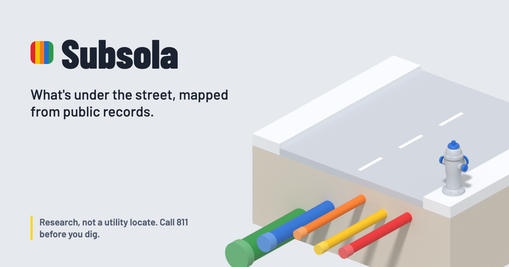
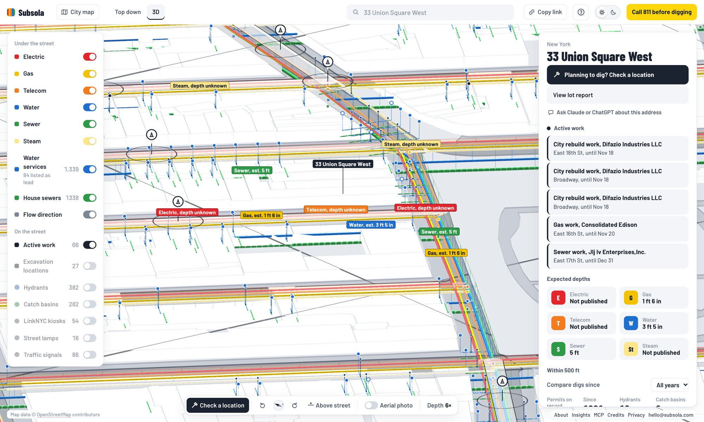
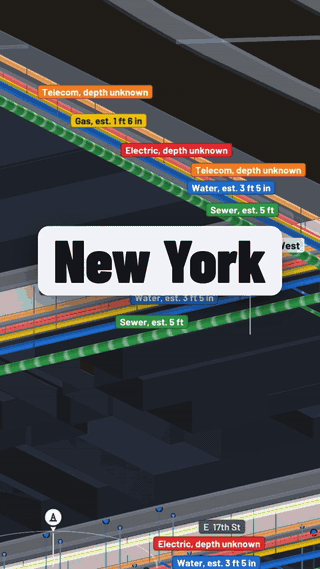
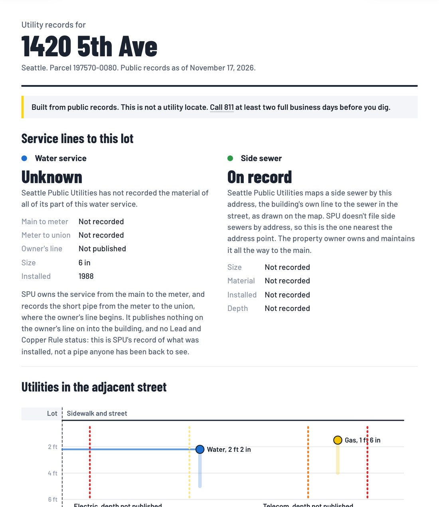
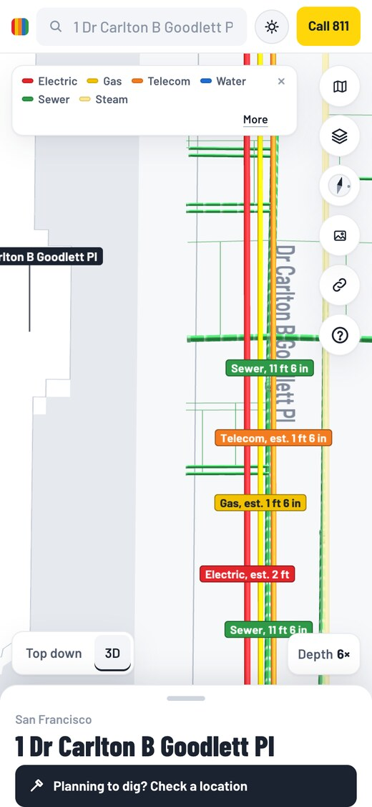

<p align="center">
  <a href="https://subsola.com"></a>
</p>

<h1 align="center">Subsola</h1>

<p align="center"><strong>Type an address. See what public records say is under the street.</strong></p>

<p align="center">
  <a href="https://github.com/juanfiguera/subsola/actions/workflows/deploy.yml"></a>
  <a href="LICENSE"></a>
  <a href="#try-it-in-your-browser"></a>
  <a href="#ask-your-ai-assistant"></a>
  <a href="#run-your-own-copy"></a>
</p>

<p align="center">
  <a href="#try-it-in-your-browser">Try it</a> &middot;
  <a href="#ask-your-ai-assistant">Ask your AI</a> &middot;
  <a href="#run-your-own-copy">Run your own</a> &middot;
  <a href="#what-youll-see">What you'll see</a> &middot;
  <a href="#cities-and-where-the-data-comes-from">Cities</a> &middot;
  <a href="#hack-on-it">Hack on it</a>
</p>

Hi, and welcome. Subsola gathers what cities and utilities already publish (excavation permits,
pipe maps, lead service line inventories, hydrants and catch basins) and turns it into a 3D
street with every utility drawn at its expected depth. Pick an address in New York City,
Washington DC, San Francisco, Los Angeles, San Diego, Seattle, Denver, Chicago or Dallas, and in a few
seconds you'll know which lines run out front, who has dug there and when, and whether the water
line to the building is lead.

It's for anyone about to dig or build: engineers doing site research, contractors scoping a
trench, buyers checking a property, or the curious. Everything here, the map, the AI assistant
server and the nightly data pipeline, is in this repo and free to run yourself.

<p align="center">
  
</p>

> [!IMPORTANT]
> **Subsola is research, not a utility locate.** Lines are drawn from public records, often at a
> standard spot in the street rather than where the pipe really is. Before you dig, call **811**
> (it's free) so the utilities mark their lines. More in [Before you dig](#before-you-dig).

## Try it in your browser

No install, no account. Open **[subsola.com](https://subsola.com)** and type an address, or jump
straight to one of these:

| City           | Try                                                                                                                    | Good for seeing                                     |
| -------------- | ---------------------------------------------------------------------------------------------------------------------- | --------------------------------------------------- |
| New York       | [33 Union Square West](https://subsola.com/?q=33%20Union%20Square%20West%2C%20New%20York%2C%20NY)                      | Steam, gas, lead lines and decades of permits       |
| Washington, DC | [800 F St NW](https://subsola.com/?q=800%20F%20St%20NW%2C%20Washington%2C%20DC)                                        | Permits from every utility downtown                 |
| San Francisco  | [1 Dr Carlton B Goodlett Pl](https://subsola.com/?q=1%20Dr%20Carlton%20B%20Goodlett%20Pl%2C%20San%20Francisco%2C%20CA) | The city's own sewer map, with measured depths      |
| Los Angeles    | [200 N Spring St](https://subsola.com/?q=200%20N%20Spring%20St%2C%20Los%20Angeles%2C%20CA)                             | Sewers and storm drains from LA Sanitation          |
| San Diego      | [100 W Broadway](https://subsola.com/?q=100%20W%20Broadway%2C%20San%20Diego%2C%20CA)                                   | Sewer and water mains from SanGIS                   |
| Seattle        | [1420 5th Ave](https://subsola.com/?q=1420%205th%20Ave%2C%20Seattle%2C%20WA)                                           | Water, sewer and electric from the owners' own maps |
| Denver         | [33 E Bayaud Ave](https://subsola.com/?q=33%20E%20Bayaud%20Ave%2C%20Denver%2C%20CO)                                    | Sewers and storm drains (beta)                      |
| Chicago        | [233 S Wacker Dr](https://subsola.com/?q=233%20S%20Wacker%20Dr%2C%20Chicago%2C%20IL)                                   | Thirty years of street opening permits (beta)       |
| Dallas         | [1500 Marilla St](https://subsola.com/?q=1500%20Marilla%20St%2C%20Dallas%2C%20TX)                                      | Right of way permits and lead line records (beta)   |

A few things to try once you're there: drag to move and right-drag to tilt, tap any line for
where it came from, press **Check a location** to drill down from a spot, and open the **lot
report** for a page you can print or save as a PDF.

<p align="center">
  
</p>

## Ask your AI assistant

Subsola is also an [MCP server](https://subsola.com/mcp), so Claude, ChatGPT, Cursor or any MCP
client can look things up for you. It's free, read-only and needs no sign-in. The server URL:

```text
https://subsola.com/mcp
```

**Claude Code**, in a terminal:

```bash
claude mcp add --transport http subsola https://subsola.com/mcp
```

**Claude** (claude.ai or the desktop app): open Customize, then Connectors, choose **Add custom
connector**, paste the URL above, and pick **No sign-in**. Steps for ChatGPT, Cursor, VS Code and
others are on [subsola.com/mcp](https://subsola.com/mcp).

Then just ask:

- _"I'm planning a 3 ft trench at 1420 5th Ave, Seattle. Which utilities run in the street in front, and how deep are they expected to be?"_
- _"We're buying 800 F St NW, Washington, DC. Has the block seen much utility work lately?"_
- _"Which utility permits near 55 Water St, New York keep getting renewed?"_

It has two tools, `whats_under` and `recent_digs`, and every answer ends with the city's 811
notice and the credits its publishers ask for.

## Run your own copy

One command gets you the map, the MCP server and a nightly data refresh for one city. You'll need
[Docker](https://docs.docker.com/get-docker/).

```bash
git clone https://github.com/juanfiguera/subsola.git && cd subsola
docker compose up
```

Grab a coffee while it builds. When the logs say **`subsola ingest: sea is live`** (about 5
minutes for Seattle, the default), open:

- **http://localhost:8080**, your own Subsola map
- **http://localhost:8080/mcp**, your own MCP server, ready for your AI assistant

What's happening behind the scenes:

- **`ingest`** downloads the city's public records straight from the publishers (about 70 MB for
  Seattle), builds the map files, swaps them in, and does it again every day. If a night's build
  fails, it keeps serving the last good one.
- **`web`** serves the map, the MCP server and those files, on the same Cloudflare runtime that
  runs subsola.com.

**Want a different city?** Set `CITY` to `nyc`, `dc`, `sf`, `la`, `sd`, `sea`, `den`, `chi` or `dal`:

```bash
CITY=sf docker compose up
```

<details>
<summary><strong>Settings, and if something goes wrong</strong></summary>

<br>

| Variable                         | Default      | What it does                                                                                         |
| -------------------------------- | ------------ | ---------------------------------------------------------------------------------------------------- |
| `CITY`                           | `sea`        | Which city to build                                                                                  |
| `PORT`                           | `8080`       | Where the map and `/mcp` listen                                                                      |
| `INGEST_EVERY_SECONDS`           | `86400`      | How long to wait between data refreshes                                                              |
| `FEEDBACK_SALT`, `REQUESTER_KEY` | placeholders | Secrets that hash visitors' IPs for rate limits and stats. Set your own if others will use your copy |

Your city's data lives in `./selfhost-data`, so it survives restarts.

- **Port 8080 is taken:** run `PORT=3000 docker compose up` and use that port instead.
- **The image build times out downloading packages:** that's a slow connection to npm. Run
  `docker compose build` again; downloads are cached, so it picks up where it stopped.
- **The map loads but the street is empty:** the first build isn't done yet. Wait for
  `is live` in the logs (`docker compose logs -f ingest`).
- **New York takes a while:** it's the biggest city by far (3.7 million permits, about an hour
  to download) and its OpenStreetMap points need `osmium-tool`. The others take minutes.
- **Analytics and error reports** are off unless you build with your own `VITE_POSTHOG_KEY`,
  `VITE_SENTRY_DSN` and `VITE_TURNSTILE_SITE_KEY`.

</details>

<details>
<summary><strong>Prefer not to use Docker?</strong></summary>

<br>

You'll need Node 22 and [pnpm](https://pnpm.io/installation).

```bash
pnpm install
CITY=sea pnpm download      # one city's public records into data/raw
CITY=sea pnpm build-cells   # the map files, into data/cells
echo "VITE_CELLS_URL=/cells" > .env.local
pnpm dev                    # http://localhost:5173
```

</details>

A copy you run carries the same credits and the same paused sources as subsola.com; see
[Cities and where the data comes from](#cities-and-where-the-data-comes-from).

## What you'll see

Every line wears the color utilities use to mark the street:

<p>     </p>

Tap a line and its card tells you how it was placed: from the **owner's own map** (the most
precise), from **excavation permits** on the block, or **inferred** from how streets are
usually built. Depths come with the code or standard behind them, or the measured depth where an
owner publishes one.

<table>
  <tr>
    <td width="68%" valign="top"><br><sub><strong>The lot report:</strong> the building's water and sewer lines, and a cross-section of the street. Print it or save it as a PDF.</sub></td>
    <td width="32%" valign="top"><br><sub><strong>On a phone:</strong> the same map, with a sheet you can pull up.</sub></td>
  </tr>
</table>

More of what the map can do, from crew dig notes to flow direction: [docs/features.md](docs/features.md).

## Before you dig

Subsola is careful to tell you how much to trust each line. Here's the short version:

- **It's not a utility locate.** Call 811 at least two working days before you dig. Each city's
  one-call center is linked on its map and in every answer.
- **Positions are approximate unless an owner publishes them.** San Francisco's and Los Angeles's
  sewers, Seattle's water, sewer and electric, San Diego's sewer and water, and Denver's sewers
  follow the owners' maps. Everywhere else, a line means permits show that utility on that block,
  and it's drawn at a standard spot in the street.
- **Depths are code minimums unless measured.** They come from installation standards, drawn at
  the shallowest depth a digger could meet the line. Electric, telecom and steam owners publish no
  burial depths, so those say "depth not published".
- **No line doesn't mean no pipe.** A line nobody has dug up since records began won't show, and
  gas, electric and telecom companies keep their routes private.
- **Records lag a little.** They're rebuilt every night, and every answer says how fresh they are.

## Cities and where the data comes from

Subsola stands on public records. These are the publishers, and the credit each one asks for:

| City           | Main sources                                                                                            | Credit required                                                                                        |
| -------------- | ------------------------------------------------------------------------------------------------------- | ------------------------------------------------------------------------------------------------------ |
| New York       | NYC Open Data (DOT permits; DEP hydrants, catch basins, lead service lines; OTI streets), OpenStreetMap | None by law today; Subsola names each dataset                                                          |
| Washington, DC | Open Data DC (DDOT permits, OCTO streets, OTR lots, DOEE outfalls)                                      | "Source: Open Data DC, [agency]; CC BY 4.0; modified by Subsola"                                       |
| San Francisco  | DataSF (Public Works permits, streets, SFMTA signals), the City's sewer and hydrant maps                | None required                                                                                          |
| Los Angeles    | City of Los Angeles GeoHub (Engineering permits, Sanitation sewers and storm drains), LA County eGIS    | None required                                                                                          |
| San Diego      | City of San Diego open data (permits), SanGIS (streets, sewers, water mains, storm drains)              | "GIS data derived, modified, reduced, and/or processed from SanGIS downloadable data - www.sangis.org" |
| Seattle        | City of Seattle open data (SDOT permits, Seattle Public Utilities, Seattle City Light)                  | None required                                                                                          |
| Denver         | City of Denver Open Data Catalog (permits, Wastewater sewers and storm drains)                          | "City of Denver Open Data Catalog", CC BY 3.0, both linked                                             |
| Chicago        | City of Chicago data portal (CDOT permits), Cook County address points                                  | Chicago's disclaimer, word for word                                                                    |
| Dallas         | City of Dallas GIS (ROW permits, DWU service lines, address points), Dallas Open Data (streets), FEMA   | None stated; Subsola credits the City of Dallas, and FEMA's buildings under CC BY 4.0                  |

The app shows these credits for you, on every city's card, in lot reports and in MCP answers.
They're all on [subsola.com/credits](https://subsola.com/credits) and in `src/attribution.ts`.

<details>
<summary><strong>Every source's terms, and the layers paused while we ask permission</strong></summary>

<br>

Subsola republishes derived public records (drawn lines, permit lists, lot reports) on the site,
in the cell files at data.subsola.com and through the MCP server. Each publisher's terms were read
on 2026-11-15; this is a reading of the terms, not legal advice. "Paid" says whether the terms
allow charging for access.

| City or layer  | Source and terms                                                                                                   | Republish                                                                                        | Paid                                                                                                                                           | Attribution                                                                                                                                                           |
| -------------- | ------------------------------------------------------------------------------------------------------------------ | ------------------------------------------------------------------------------------------------ | ---------------------------------------------------------------------------------------------------------------------------------------------- | --------------------------------------------------------------------------------------------------------------------------------------------------------------------- |
| New York       | NYC Open Data; NYC Admin. Code §23-502(d): "no restrictions on their use" (no license, not formally public domain) | Yes                                                                                              | Yes                                                                                                                                            | None now; the City may require naming the dataset, its version and our changes, so cards cite each dataset                                                            |
| New York       | NYS ITS orthoimagery                                                                                               | Not stated                                                                                       | Not stated                                                                                                                                     | Courtesy: "NYS ITS Geospatial Services"                                                                                                                               |
| New York       | Con Edison structures map                                                                                          | **No** without written consent (coned.com terms)                                                 | **No**                                                                                                                                         | None                                                                                                                                                                  |
| Washington, DC | Open Data DC; each layer CC BY 4.0                                                                                 | Yes                                                                                              | Yes                                                                                                                                            | **Required**: "Source: Open Data DC (opendata.dc.gov), [agency]; CC BY 4.0; modified by Subsola"                                                                      |
| Washington, DC | DC Water mains and lead service lines (geo.dcwater.com)                                                            | **No**: "not for any commercial, legal or other use"                                             | **No**                                                                                                                                         | None                                                                                                                                                                  |
| San Francisco  | DataSF, PDDL 1.0                                                                                                   | Yes                                                                                              | Yes                                                                                                                                            | Not required; credit San Francisco Public Works, SFMTA                                                                                                                |
| San Francisco  | City ArcGIS services (sewers, hydrants, lights, aerial tiles)                                                      | Not stated                                                                                       | Not stated                                                                                                                                     | Courtesy: City and County of San Francisco                                                                                                                            |
| Los Angeles    | GeoHub layers (permits, sewers, storm drains, hydrants, lights, signals, sidewalks)                                | Not stated (`license: none`)                                                                     | Not stated                                                                                                                                     | Courtesy: City of Los Angeles, Bureau of Engineering                                                                                                                  |
| Los Angeles    | LA County eGIS (buildings, geocoder)                                                                               | Yes, "commercial and/or personal use"                                                            | Yes                                                                                                                                            | Not required; no implied County endorsement                                                                                                                           |
| San Diego      | data.sandiego.gov, PDDL (permits)                                                                                  | Yes                                                                                              | Yes                                                                                                                                            | Not required                                                                                                                                                          |
| San Diego      | webmaps.sandiego.gov layers (lights, signals)                                                                      | **Not for commercial use or mirroring** (sandiego.gov terms; PDDL covers only portal downloads)  | **No**                                                                                                                                         | None                                                                                                                                                                  |
| San Diego      | SanGIS layers (streets, buildings, sewers, water, hydrants, storm drains)                                          | Allowed, "discouraged"                                                                           | Yes, except insurance and emergency response uses                                                                                              | **Required wording**: "GIS data derived, modified, reduced, and/or processed from SanGIS downloadable data - www.sangis.org"; never SanGIS as the sole source         |
| San Diego      | Lead service line inventory                                                                                        | **No**: "any sale, reproduction or distribution... expressly prohibited"                         | **No**                                                                                                                                         | None                                                                                                                                                                  |
| Seattle        | Seattle open data terms                                                                                            | Yes                                                                                              | Yes, except data that works as a list of individuals                                                                                           | None required                                                                                                                                                         |
| Seattle        | King County geocoder                                                                                               | Yes                                                                                              | **No sale** without a written agreement                                                                                                        | None                                                                                                                                                                  |
| Denver         | Denver Open Data, CC BY 3.0                                                                                        | Yes                                                                                              | Yes                                                                                                                                            | **Required**: "City of Denver Open Data Catalog" linked to data.denvergov.org, and "CC BY 3.0" linked to the license; sewer layers say "not for engineering purposes" |
| Denver         | Denver Water lead service line map                                                                                 | **No**: "reproduction or distribution... expressly prohibited"                                   | **No**                                                                                                                                         | None                                                                                                                                                                  |
| Chicago        | City of Chicago data portal terms                                                                                  | Yes, as a modified-data application                                                              | Not addressed                                                                                                                                  | **Required disclaimer**, verbatim, where the app is accessed (below)                                                                                                  |
| Chicago        | Cook County address points (geocoder)                                                                              | Yes, public domain                                                                               | Yes                                                                                                                                            | Courtesy: Cook County GIS                                                                                                                                             |
| Dallas         | City of Dallas GIS and Dallas Open Data (permits, service lines, streets, address points); no license set          | Not stated; the city's GIS disclaimer gives the data as is, with an indemnity, and bans no reuse | **Unclear**: dallascityhall.com bars commercial use of its own materials without permission; whether that reaches the GIS layers is not stated | Not required; Subsola credits the City of Dallas                                                                                                                      |
| Dallas         | FEMA and ORNL USA Structures (buildings), CC BY 4.0                                                                | Yes                                                                                              | Yes                                                                                                                                            | **Required**: credit and license link                                                                                                                                 |
| All            | OpenStreetMap, ODbL 1.0                                                                                            | Yes, share-alike                                                                                 | Yes, but OSM-derived data must stay free to download                                                                                           | **Required**: "© OpenStreetMap contributors" linked to openstreetmap.org/copyright, in the map and inside the cell files                                              |
| All            | OpenFreeMap basemap (OpenMapTiles schema, CC BY 4.0)                                                               | Yes                                                                                              | Yes                                                                                                                                            | **Required**: "OpenFreeMap © OpenMapTiles Data from OpenStreetMap" (MapLibre shows it from the tiles)                                                                 |
| Some cities    | USGS NAIP imagery                                                                                                  | Yes, public domain                                                                               | Yes                                                                                                                                            | Courtesy: "U.S. Geological Survey"                                                                                                                                    |
| All            | Google Fonts (Barlow), SIL OFL 1.1                                                                                 | Yes                                                                                              | Yes                                                                                                                                            | None                                                                                                                                                                  |

**Where credits appear.** The wording lives in `src/attribution.ts` and is used everywhere: the
[credits page](https://subsola.com/credits) (every city, Chicago's disclaimer, what is paused),
linked from the map's corner links and every page footer; the foot of each city's card on the map
(that city's credit and aerial photo credit); each lot report's sources footer; a `credits` field
and "Data credits" line in every MCP answer; and a `credits` entry in each cell file and in
`index.json` on data.subsola.com, with the ODbL notice for the OpenStreetMap-derived layers. The
city map shows OpenFreeMap's and OpenStreetMap's credit through MapLibre's attribution control.

**Chicago's required disclaimer**, to appear wherever the app can be accessed:

> This site provides applications using data that has been modified for use from its original
> source, www.cityofchicago.org, the official website of the City of Chicago. The City of
> Chicago makes no claims as to the content, accuracy, timeliness, or completeness of any of the
> data provided at this site. The data provided at this site is subject to change at any time.
> It is understood that the data provided at this site is being used at one's own risk.

**Conditions nearly every publisher shares**: the data comes as is, unverified and not for
engineering, surveying or legal use; no implying a city or utility endorses Subsola; and, for
DataSF, San Diego, SanGIS, SANDAG and LA County, an indemnity. The site and every MCP answer
already say the data is public-records evidence, not a survey, and to call 811.

**OpenStreetMap share-alike.** The `osm` layer in each cell file, and city signals de-duplicated
against OSM, are an ODbL derivative database: they must stay under ODbL and free to download,
with the attribution and a license link inside the data, whatever a paid tier charges for.
OpenStreetMap points come only from Geofabrik's daily extract in the nightly build; the app
never queries the volunteer-run Overpass servers, whose usage policy rules out commercial use.

**Paused for their terms** (2026-11-15): Con Edison structures, DC Water mains and lead service
lines, Denver Water's and San Diego's lead service line inventories, and San Diego's street lights
and signals (from webmaps.sandiego.gov, whose terms forbid mirroring). `PAUSED_SOURCES` in
`src/sources/catalog.ts` holds them back from every payload: the nightly build skips them, cells
built before the pause are filtered as they load (map, lot reports, MCP, share images), and lot
reports and answers say the record is paused and link to the publisher's own map. Permission has
been asked of each publisher; removing an entry brings the source back with the next build. San
Diego's permits moved to the city's open data portal (PDDL) instead of being paused.

</details>

## Hack on it

Glad you're here. Getting set up takes a minute:

```bash
pnpm install
pnpm dev          # http://localhost:5173 (New York loads live from NYC Open Data)
pnpm test         # unit tests
pnpm typecheck && pnpm lint
pnpm build
```

How it fits together:

```text
city and utility open data
        |  nightly: pnpm download, then pnpm build-cells
        v
250 m map cells (data/cells, or data.subsola.com)
        |
        +--> the map (src/)            3D street, cards, lot reports
        +--> the MCP server (server/)  whats_under, recent_digs at /mcp
```

- **The full build:** `pnpm download` fetches every city's records (it resumes if stopped),
  `pnpm download-osm` adds OpenStreetMap's manholes, lamps and signals for New York (needs
  `osmium-tool`), `pnpm build-cells` writes about 80,000 cells, and `pnpm insights` writes the
  figures behind [subsola.com/insights](https://subsola.com/insights).
- **Visual tests:** `pnpm test:visual` replays recorded network traffic and compares screenshots
  (Linux baselines come from CI).
- **Each city's details**, from quirks in its permits to what it doesn't publish, are in
  [docs/regions/](docs/regions/). The MCP server is described in [docs/mcp.md](docs/mcp.md).

<details>
<summary><strong>How depths are chosen</strong></summary>

<br>

No NYC dataset publishes pipe depths, so the scene uses installation standards and draws each
pipe at its **shallowest expected depth**: the depth a digger would hit it first.

| Utility                  | Range drawn                 | Basis                                                                                                                                                                           |
| ------------------------ | --------------------------- | ------------------------------------------------------------------------------------------------------------------------------------------------------------------------------- |
| Gas                      | 1.5 to 4 ft                 | [49 CFR 192.327(b)](https://www.law.cornell.edu/cfr/text/49/192.327) (24 in mains), [192.361](https://www.law.cornell.edu/cfr/text/49/192.361) (18 in services in streets)      |
| Water                    | 3.4 to 5 ft                 | [NYC DDC Water Main Standard Specifications](https://www.nyc.gov/assets/ddc/downloads/publications/infrastructure/watermain_std_specs_090801.pdf), p. 89 (3'-5" to 4'-0" cover) |
| Sewer                    | 5 to 25 ft                  | [NYC DEP Sewer Design Standards](https://www.nyc.gov/assets/dep/downloads/pdf/about/water-and-sewer-forms/sewer-design-standards.pdf) (details for 5 to 25 ft cover)            |
| Electric, telecom, steam | 0.5 to 6 ft, marked unknown | Owners do not publish burial specs                                                                                                                                              |

Depth is stretched 6x by default (1x, 2x, 4x, 6x, 8x or 10x) because real depths look flat at street
scale; every label stays in real feet. Utilities are drawn side by side because their exact
position in the street is not public, except where crew dig notes place a lane (see Crew dig
spots).

</details>

<details>
<summary><strong>Where things live</strong></summary>

<br>

- `src/sources/` one module per data source, all validated with Zod
- `src/scene/` the 3D world: `local.ts` (meters around the address), `build.ts` (data to
  geometry), `scene.ts` (deck.gl orthographic orbit view and layers), `pins.ts` (map pin icons)
- `src/ui/` details cards, layer list, history chart
- `src/depth.ts` depth standards with citations
- `src/brief.ts` per-utility summary

</details>

### Contributing

Issues and pull requests are welcome, from a typo to a new city. A few pointers:

- **Spotted a wrong line or a missing source?** Open an issue with the address; that's often
  enough for us to find it.
- **Adding a city?** Copy the shape of an existing one: its datasets and build in `pipeline/<city>/`,
  its depth rules in `src/depth.ts`, its region in `src/regions.ts`, and a write-up in
  `docs/regions/`. Check its data terms first and add its credit to `src/attribution.ts`.
- **Before a pull request,** run `pnpm typecheck`, `pnpm lint` and `pnpm test`.
- **Your first pull request** asks you to agree to the [contributor license agreement](CLA.md)
  by replying with one sentence. You keep the copyright in your work.
- **Publishers:** if you'd like your data credited differently, email
  [hello@subsola.com](mailto:hello@subsola.com).

## License

Subsola is free software under the [GNU Affero General Public License v3.0](LICENSE). Use it,
change it and share it; if you run a changed version for others over a network, offer them its
source too. The Subsola name and logo are not covered by this license: run your own copy under
any name, but a public copy needs a name of its own. See [TRADEMARKS.md](TRADEMARKS.md).

The public records it reads belong to their publishers and carry their own terms, listed above.

<p align="center"><sub>Questions or ideas? <a href="mailto:hello@subsola.com">hello@subsola.com</a></sub></p>
